# Sesión 2 · Errores, pagos por correo con IA y el agente

> Estás en la rama **`sesion-2`**. La vista general de la clase está en `main`.

**Duración:** ~2 h · **Pasos 6 a 9** · **Flujos 00 y 03**

**Qué vas a hacer:** que Marisa se entere cuando algo falla, construir el flujo difícil (**leer los correos del banco con IA y registrar los pagos**), pedirle un flujo nuevo a un agente y subirlo todo a tu repositorio.

---

## Punto de partida

Esta sesión continúa la anterior. Necesitas:

| Necesitas | Cómo comprobarlo | Si no lo tienes |
|---|---|---|
| Todo levantado | `docker compose ps` muestra `pasteleria`, `n8n` y `mailpit` | `cp .env.example .env && docker compose up -d` |
| Las 3 credenciales de n8n: `Mailpit`, `API Pastelería` y `Groq` | n8n → *Credentials* | Créalas con la tabla de abajo |
| Los flujos **01** y **02** funcionando y publicados | n8n → *Workflows* | Impórtalos de `referencia/` (*Import from file*), elige tus credenciales en cada nodo con triángulo rojo y publícalos |

| Tipo | Nombre | Qué rellenar |
|---|---|---|
| **SMTP** | `Mailpit` | Host `mailpit` · Port `1025` · User y Password vacíos · SSL/TLS desactivado |
| **Header Auth** | `API Pastelería` | Name `X-API-Key` · Value: tu `API_KEY` del `.env` |
| **Groq** | `Groq` | Tu API key de Groq |

> Recuerda: dentro de n8n, `localhost` es **su propio contenedor**. Usa `mailpit` y `http://pasteleria:8000`.

Si empezaste la clase en otra máquina o borraste los datos (`down -v`), los datos de ejemplo se recargan solos.

---

## Paso 6 — Flujo 00: avisar si algo falla (15 min)

**Objetivo:** que Marisa se entere cuando una automatización falla, en vez de descubrirlo semanas después.

Así queda el flujo terminado:

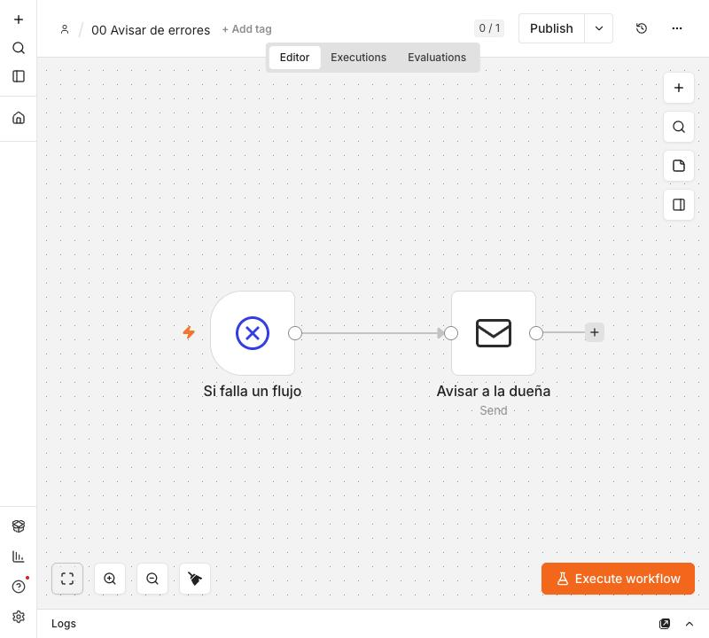
*Flujo 00: un disparador de errores y un correo*

1. Nuevo flujo: `00 Avisar de errores`.
2. Primer nodo: **Error Trigger** (renómbralo `Si falla un flujo`).
3. Nodo **Send Email** `Avisar a Marisa`: credencial `Mailpit`, To `marisa@lacuchara.example`.
   - Subject: `Ha fallado el flujo «{{ $json.workflow.name }}»`
   - Text:

```
Hola Marisa,

Una automatización ha fallado.

Flujo: {{ $json.workflow.name }}
Paso: {{ $json.execution.lastNodeExecuted }}
Error: {{ $json.execution.error.message }}
Ejecución: {{ $json.execution.url }}
```

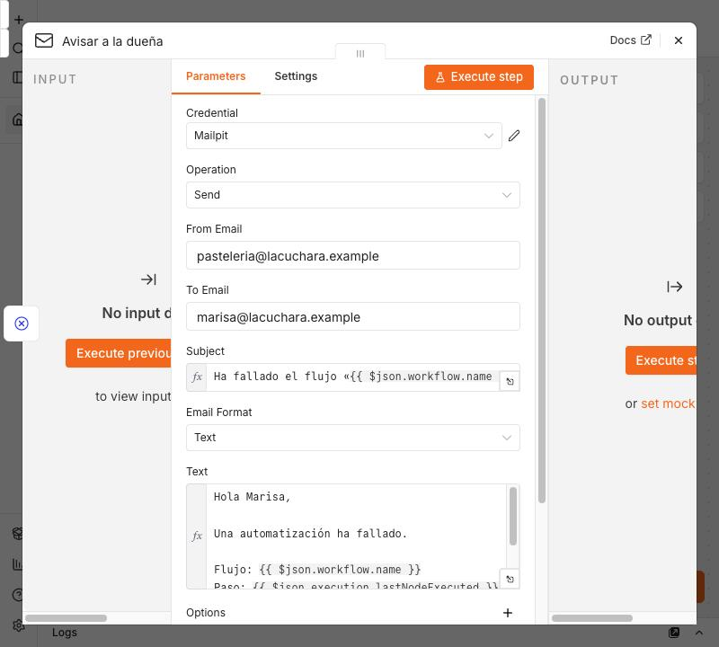
*El nodo «Avisar a la dueña»: asunto y texto con los datos del error*

4. **Publish** (confirma la ventana del nombre de versión, como en la sesión 1).
5. **Conéctalo a los otros flujos.** Abre el flujo `01`, menú `···` → **Settings** → **Error workflow** → elige `00 Avisar de errores` → **Save**. Repite en el `02` (y más tarde en el `03`).

   
   *El menú `···` del flujo: aquí están Settings, Download e Import from file*

   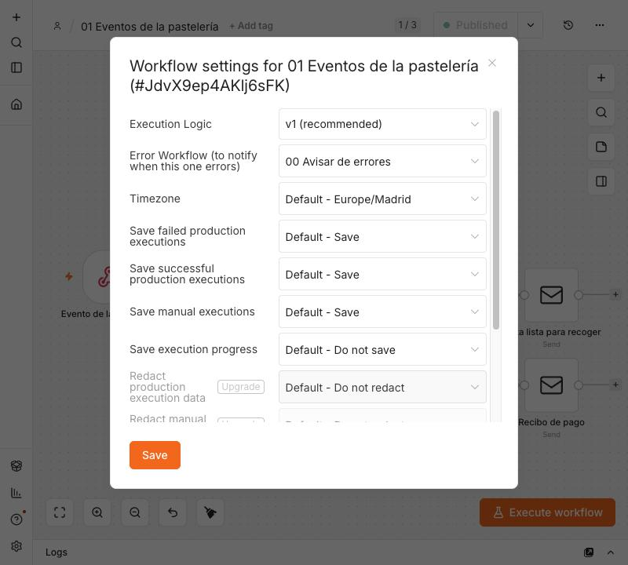
   *En Settings, el campo «Error Workflow» apunta al flujo 00*

6. **Provócalo.** Con el `01` publicado, envía un evento roto (sin `datos`):

```bash
curl -X POST http://localhost:5678/webhook/pasteleria \
  -H "Content-Type: application/json" -d '{"evento":"encargo.creado"}'
```

   El flujo 01 falla (no hay a quién enviar el correo) y en Mailpit aparece el aviso: flujo `01 Eventos de la pastelería`, paso `Confirmar encargo` y error `No recipients defined`.

   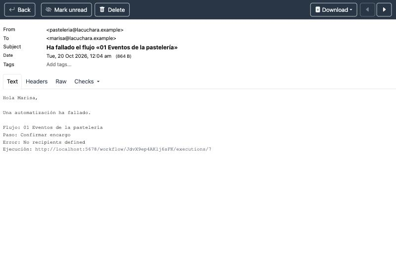
   *El aviso que recibe Marisa: flujo, paso y error*


   > Para que el aviso salga, el flujo `00` tiene que estar **publicado**. Si no lo está, n8n lo anota en sus registros (`Workflow ... is not active`) y no avisa a nadie.

> **Seguridad:** el aviso lleva el nombre del flujo, el paso y el mensaje, **nunca** claves ni contraseñas. Revisa el correo antes de dar el flujo por bueno.

**Checkpoint:** un fallo provocado genera un correo de aviso.

---

## Paso 7 — Flujo 03: leer los correos del banco con IA (50 min)

Es el flujo más difícil de la clase. **Objetivo:** cuando llega un aviso del banco de que un cliente ha pagado por Bizum o transferencia, registrar el pago en el encargo correcto, **sin que Marisa apunte nada**.

> **La regla de oro: la IA lee, el código decide.** La IA solo sirve para convertir un texto desordenado (el correo) en datos ordenados (quién, cuánto, para qué). **Qué encargo es y si se puede registrar lo decide un nodo de código con reglas claras**, porque una IA a veces se equivoca y un pago mal asignado es dinero mal apuntado.

```
 Pegar correo ──▶ IA: extraer datos ──▶ ¿es un pago? ──sí──▶ GET encargos pendientes ──▶ Code: buscar el encargo
                                              │ no                                              │
                                              ▼                                                 ▼
                                      Ignorar (publicidad)                         ¿se puede registrar?
                                                                              sí ──▶ POST pago a la app
                                                                              no ──▶ Correo a Marisa: "revisa esto"
```

En un negocio real el disparador sería un **correo nuevo** (Gmail o IMAP). Aquí usamos un **formulario donde pegas el texto del correo**, que es más fácil de probar y no necesita ninguna cuenta. Cambiarlo después es sustituir un solo nodo.

Así queda el flujo terminado (puedes volver a esta imagen para comprobar el tuyo):

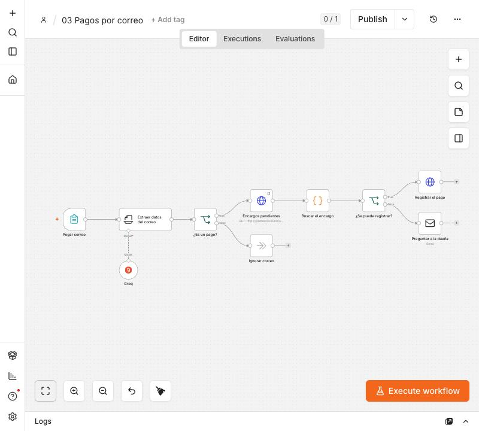
*Flujo 03 completo: formulario, IA, decisión, consulta a la app, código, y registrar o preguntar*

### Los correos de prueba

Están en `data/correos/`. Son 7 y cubren los casos que tu flujo debe resolver:

| Archivo | Qué pasa | Resultado esperado |
|---|---|---|
| `01_bizum_carmen` | Ordenante con nombre y dos apellidos, un solo encargo posible | Se registra el pago (12 €) → el encargo #1 queda **pagado** |
| `02_bizum_jorge` | Ordenante abreviado (`JORGE M.`), pero el concepto dice `encargo 2` | Se registra el pago (15 €) en el encargo #2 |
| `03_transferencia_lucia` | Transferencia, nombre completo | Se registra (10 €) → el encargo #3 queda **pagado** |
| `04_bizum_laura_de_mas` | Paga 10 € pero al encargo solo le faltan 5 € | **No se registra**: aviso a Marisa |
| `05_bizum_ana_ya_pagado` | Ana ya tiene su encargo pagado | **No se registra**: aviso a Marisa |
| `06_transferencia_desconocido` | Nadie con ese nombre | **No se registra**: aviso a Marisa |
| `07_publicidad_banco` | No es un pago | Se **ignora**, sin avisar a nadie |

> Los datos de ejemplo se cargan con **fechas de hoy**, así que estos casos funcionan cualquier día. Pero **cada pago que registras cambia la app**: si repites un caso, el resultado cambia (el encargo ya estará pagado). Para volver al principio **sin tocar tus flujos**, restablece solo los datos de la app:
>
> ```bash
> curl -X POST http://localhost:8000/api/reset -H "X-API-Key: cambia-esta-clave"
> ```

### 7.1 El disparador: pegar el correo

Nuevo flujo `03 Pagos por correo`. Primer nodo: **On form submission** (*Form Trigger*), renómbralo `Pegar correo`:

| Campo | Valor |
|---|---|
| Form Title | `Correo del banco` |
| Form Elements → Add (+) → Field Name | `Correo` |
| Form Elements → Element Type | `Textarea` |
| Form Elements → Required Field | activado |

Pulsa **Execute step** y se abre un formulario en el navegador. Pega el contenido de `data/correos/01_bizum_carmen.txt` y envía.

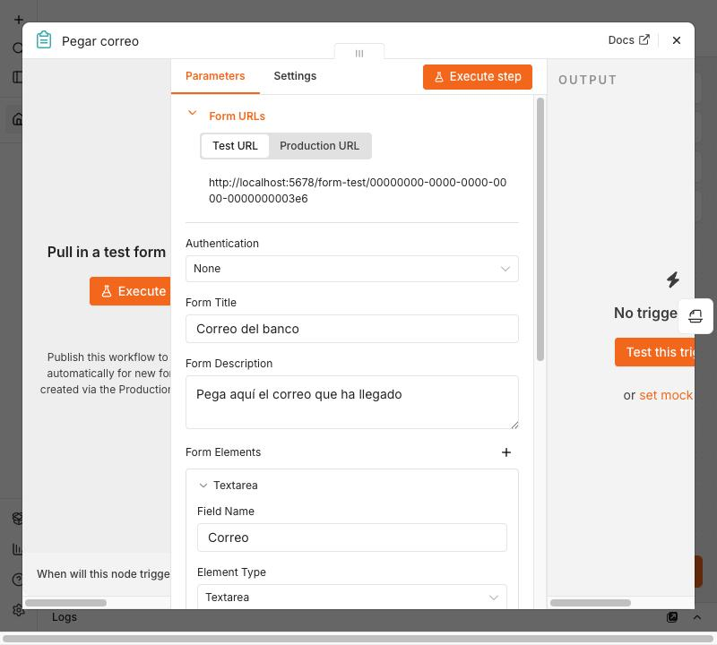
*El nodo «Pegar correo»*

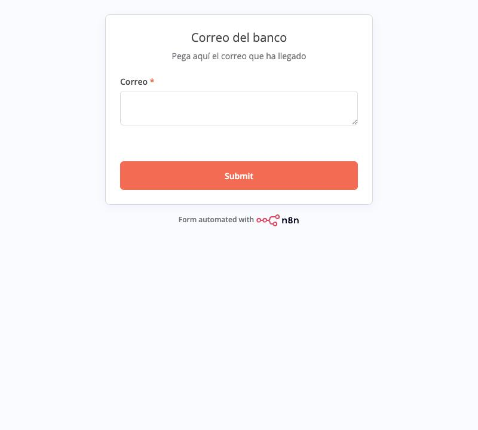
*El formulario que se abre en el navegador*

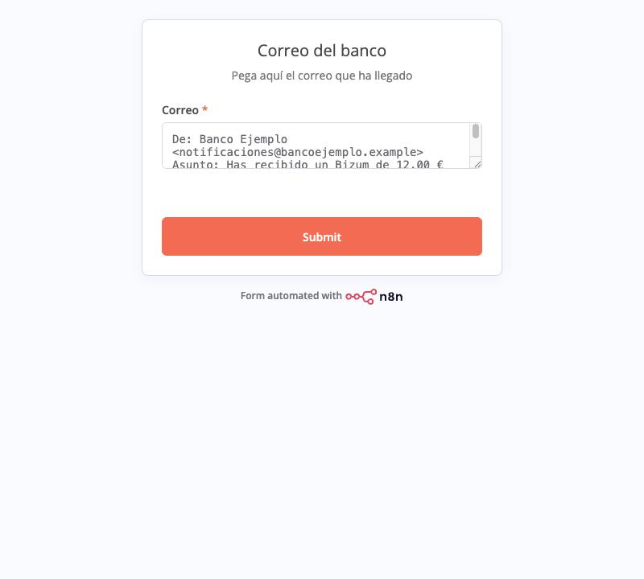
*Pega aquí el texto del correo y pulsa Submit (la imagen muestra uno ya pegado)*


### 7.2 La IA extrae los datos

1. Añade el nodo **Information Extractor** (de la sección AI) llamado `Extraer datos del correo`:

| Campo | Valor |
|---|---|
| Text | `{{ $json.Correo }}` |
| Schema Type | `Generate From JSON Example` |
| JSON Example | ver abajo |
| Options → **System Prompt Template** | ver abajo |

JSON Example (le dice a la IA la forma exacta de la respuesta; n8n avisa de que **todas las propiedades serán obligatorias**, está bien):

```json
{ "es_pago": true, "ordenante": "CARMEN RUIZ", "importe": 12.5, "forma": "bizum", "concepto": "tarta queso" }
```

System Prompt Template (pulsa *Add option* → *System Prompt Template*):

```
Eres un asistente que lee correos de un banco para una pastelería. Decide si el correo avisa de un pago recibido (Bizum o transferencia): es_pago=true; si es publicidad u otra cosa, es_pago=false. Extrae el nombre de quien paga (ordenante), el importe como número con punto decimal, la forma (bizum o transferencia) y el concepto. Si un dato no aparece, déjalo vacío. No inventes nada.
```


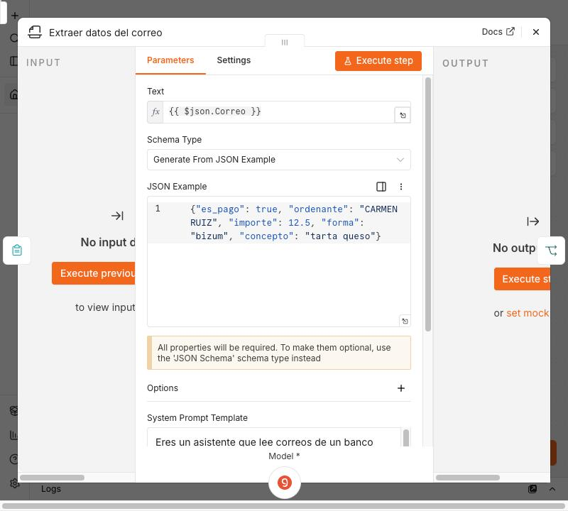
*El nodo Information Extractor: texto, ejemplo de JSON...*

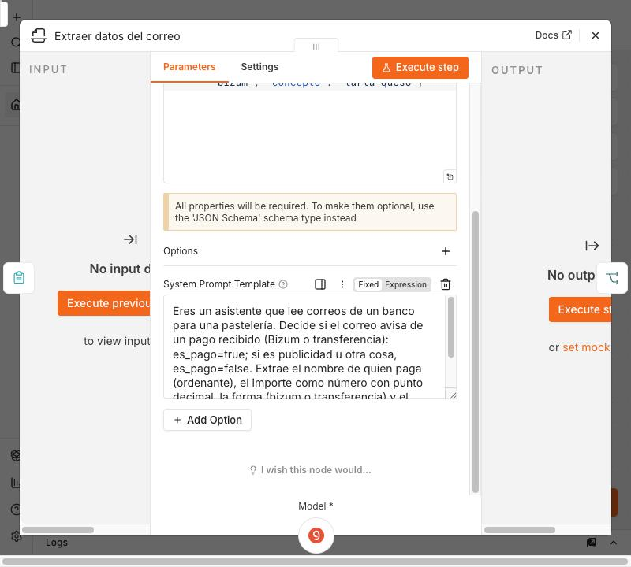
*...y más abajo, el System Prompt Template*

2. El nodo tiene un conector inferior **Model**. Pulsa el `+`, elige **Groq Chat Model**, credencial `Groq`, **Model** `llama-3.3-70b-versatile`. En *Add option* → **Sampling Temperature** `0` (así responde siempre igual al mismo correo).
3. **Execute step.** En Output debe aparecer `output.ordenante = "CARMEN RUIZ GARCIA"`, `output.importe = 12`, `output.forma = "bizum"`.
4. **Pruébalo con los 7 correos.** Fíjate sobre todo en el `07` (`es_pago` debe ser `false`) y el `02` (`ordenante` = `JORGE M.`, `concepto` = `encargo 2`).

> Si algún campo sale mal, **mejora el prompt**, no añadas parches de código. Anota el cambio en tu bitácora de IA.

### 7.3 ¿Es un pago?

Nodo **IF** `¿Es un pago?`: Value 1 `{{ $json.output.es_pago }}` → Boolean → **is true**.
La salida **false** conecta a un nodo **No Operation, do nothing** llamado `Ignorar correo`: aquí termina la publicidad.


*El IF «¿Es un pago?»: `es_pago` es true*


### 7.4 Pedir a la app los encargos pendientes

En la salida **true**, nodo **HTTP Request** `Encargos pendientes`: Method `GET`, URL `http://pasteleria:8000/api/encargos`, la misma autenticación Header Auth (`API Pastelería`), Query `estado` = `pendiente`, y **Always Output Data** activado en Settings.


*El nodo «Encargos pendientes»: GET a la API con la credencial y `estado=pendiente`*


### 7.5 El código que decide

Nodo **Code** `Buscar el encargo` (*Run Once for All Items*). Cuando algo no está claro, **nunca registra**: avisa a Marisa.

```javascript
const datos = $('Extraer datos del correo').first().json.output;
const pendientes = $input.all().map(i => i.json).filter(e => e.id);
const norm = s => (s || '').toLowerCase().normalize('NFD').replace(/[̀-ͯ]/g, '').replace(/[^a-z0-9 ]/g, ' ').trim();

let candidatos = [];
const porNumero = norm(datos.concepto).match(/(?:encargo|pedido)\s*(\d+)/);
if (porNumero) {
  candidatos = pendientes.filter(e => e.id === Number(porNumero[1]));
} else {
  // Nombre: el primer nombre coincide y el siguiente apellido empieza igual (sirve "JORGE M.")
  const t = norm(datos.ordenante).split(/\s+/).filter(Boolean);
  candidatos = pendientes.filter(e => {
    const c = norm(e.cliente).split(/\s+/);
    return t.length >= 2 && c[0] === t[0] && c.slice(1).some(w => w.startsWith(t[1]) || t[1].startsWith(w));
  });
}

const base = { ordenante: datos.ordenante, importe: datos.importe, forma: datos.forma, concepto: datos.concepto };
if (candidatos.length !== 1)
  return [{ json: { ...base, decision: 'revisar', motivo: candidatos.length ? 'Hay varios encargos posibles' : 'No he encontrado ningún encargo pendiente de esa persona' } }];
const e = candidatos[0];
if (datos.importe > e.pendiente)
  return [{ json: { ...base, decision: 'revisar', encargo_id: e.id, motivo: `Paga ${datos.importe} € pero al encargo #${e.id} solo le faltan ${e.pendiente} €` } }];
return [{ json: { ...base, decision: 'registrar', encargo_id: e.id, motivo: 'Coincide con un único encargo' } }];
```

| Parte | Qué hace |
|---|---|
| `norm` | Quita tildes, mayúsculas y signos para comparar `LUCIA GOMEZ` con `Lucía Gómez` |
| `porNumero` | Si el concepto dice `encargo 2`, ese número manda sobre el nombre |
| `candidatos` | Los encargos pendientes que podrían ser de esta persona |
| Las dos comprobaciones finales | Solo registra si hay **exactamente un** candidato y **no se paga de más** |


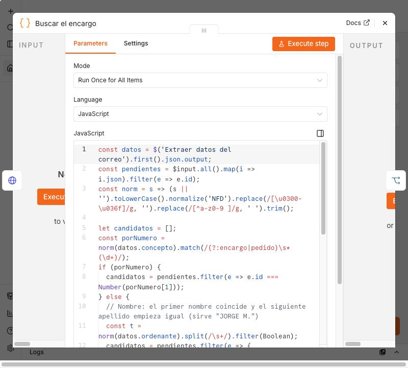
*El nodo Code «Buscar el encargo» (el código completo está justo encima)*

### 7.6 Registrar o preguntar

Nodo **IF** `¿Se puede registrar?`: Value 1 `{{ $json.decision }}` → String → is equal to → `registrar`.

- Salida **true** → nodo **HTTP Request** `Registrar el pago`:
  - Method `POST`, URL (en modo expresión) `http://pasteleria:8000/api/encargos/{{ $json.encargo_id }}/pagos`, misma autenticación.
  - **Send Body** activado, Body Content Type `JSON`, **Specify Body** `Using JSON`, JSON: `{ "importe": {{ $json.importe }}, "forma_pago": "{{ $json.forma }}" }`
- Salida **false** → nodo **Send Email** `Preguntar a Marisa`: To `marisa@lacuchara.example`, Subject `Pago para revisar: {{ $json.importe }} € de {{ $json.ordenante }}`, Text:

```
Hola Marisa,

Ha llegado un pago y no lo he registrado.

Motivo: {{ $json.motivo }}

Ordenante: {{ $json.ordenante }}
Importe: {{ $json.importe }} €
Forma: {{ $json.forma }}
Concepto: {{ $json.concepto }}

Regístralo tú si es correcto.
```


*El IF «¿Se puede registrar?»: `decision` igual a `registrar`*

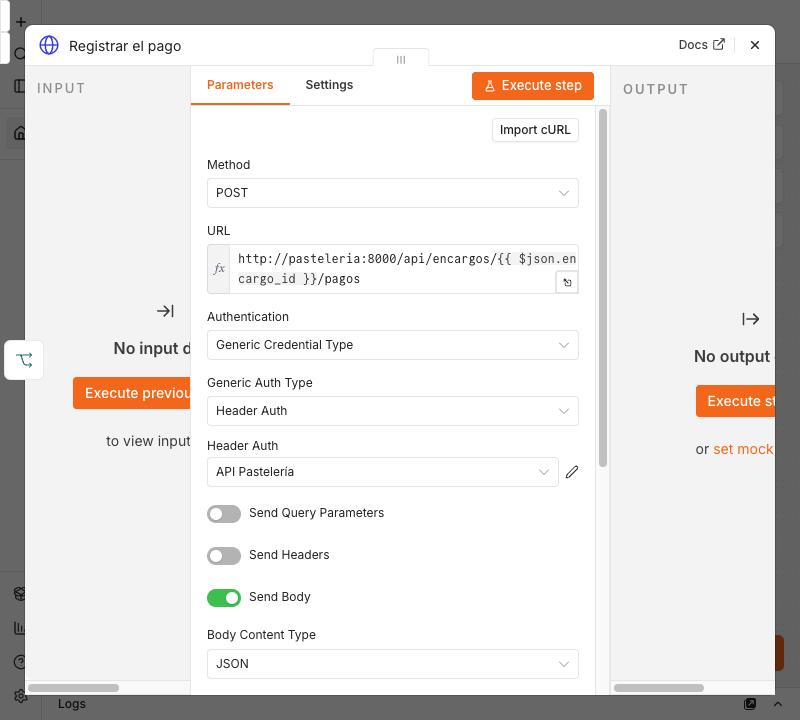
*El nodo «Registrar el pago»: método POST y la URL con el número del encargo*

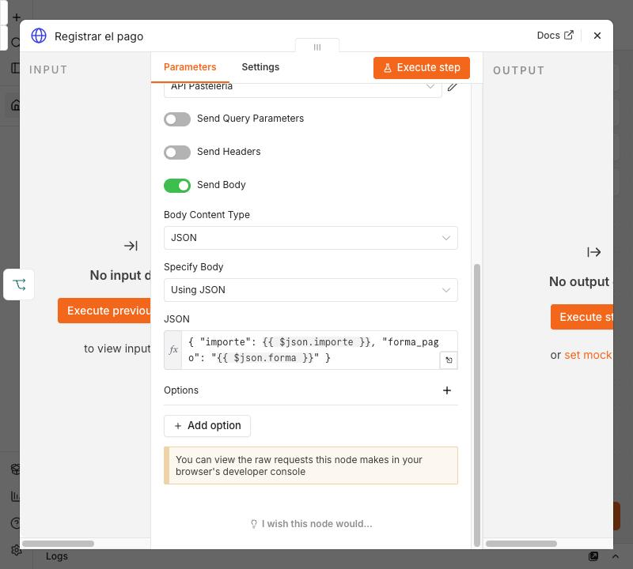
*El cuerpo JSON de la petición: importe y forma de pago*


*El nodo «Preguntar a la dueña»*

> **Un detalle que ahorra trabajo:** al registrar el pago, la app avisa de `pago.registrado` y **el flujo 01 manda solo el recibo al cliente** (o el "ya está pagado"). No hay que enviarlo desde aquí. Los flujos se encadenan a través de la app.

### 7.7 Probarlos todos

Pega cada uno de los 7 correos (restableciendo los datos si repites) y comprueba la tabla de resultados esperados. Para cada caso mira:

- **Mailpit:** ¿ha salido el correo a Marisa, o el recibo al cliente?
- **La ficha del encargo** en la app: ¿ha cambiado lo pagado?
- **Executions:** ¿por qué rama fue?

Cuando funcionen, **publica** el flujo y asígnale `00 Avisar de errores` como *Error workflow*.

**Checkpoint:** los 7 casos dan el resultado de la tabla. Marisa ya no apunta a mano los pagos que llegan por el banco.

---

## Paso 8 — Repetir un flujo con el agente (30 min)

Hasta aquí has construido a mano para entender cada pieza. Ahora trabajarás con un agente de IA: le pides **un flujo nuevo** y tú haces de *tech lead*: defines, revisas y decides.

### 8.1 Dale contexto: `AGENTS.md`

Crea este archivo en la raíz de tu carpeta y adáptalo:

```markdown
# Pastelería La Cuchara: automatizaciones con n8n

- La app (http://pasteleria:8000 dentro de Docker) guarda encargos y pagos. Se usa por API con la cabecera X-API-Key (credencial "API Pastelería" en n8n).
- n8n corre en Docker. Los correos salen por la credencial SMTP "Mailpit".
- Los flujos se guardan como JSON en `mis-flujos/` con el formato `NN-nombre.json`.
- Los importes siempre los calcula la app: n8n solo los muestra.
- NO escribir credenciales ni claves dentro de los JSON. NO publicar flujos sin que yo los haya probado.
```

### 8.2 Escribe la spec antes de pedir nada

Ejemplo para un flujo nuevo, **Aviso de entrega mañana**:

```markdown
## Spec: aviso de entrega mañana
- Disparador: cada día a las 9:00.
- Pide a la API los encargos `pendiente` y `pagado` con `fecha_entrega` de mañana (GET /api/encargos).
- Si un encargo está `pagado`: correo al cliente "Mañana puedes recoger tu tarta".
- Si está `pendiente`: correo al cliente "Mañana es la entrega y aún te faltan X €".
- Si hay entregas mañana, un solo correo a Marisa con la lista. Si no hay ninguna, no se envía nada.
- Criterios de aceptación: con los datos de ejemplo, el resultado coincide con lo que dice la app; no falla si no hay entregas.
```

### 8.3 Pídeselo al agente y revísalo

1. Abre OpenCode en la carpeta y pega la spec con una frase como: *"Lee AGENTS.md y esta spec. Genera el flujo como un JSON importable en `mis-flujos/04-aviso-entrega.json`."*
2. En n8n: **Import from file** (menú `···` del flujo, imagen del Paso 6). Las credenciales llegan sin asignar: abre cada nodo con un aviso y selecciona la tuya.
3. **Revisa como si lo hubiera hecho otra persona**, con esta lista:

| Comprobación | ¿Está bien? |
|---|---|
| Los importes los toma de la app, no los calcula | |
| No hay claves escritas en los nodos | |
| Funciona con el caso de no haber entregas mañana | |
| Los nombres de los nodos se entienden | |
| Los textos de los correos son correctos | |

4. Si falla, **pásale el error y el flujo** (no solo "no funciona") y pide la corrección.
5. Anota en `docs/ai-log.md`: el prompt, qué hizo bien, qué tuvo que corregirse.

> **Opcional:** [n8n-mcp](https://github.com/czlonkowski/n8n-mcp) conecta el agente con tu n8n (necesita una API key de n8n: *Settings → n8n API*) para que cree y pruebe los flujos él mismo. Úsalo cuando ya domines lo básico.

---

## Paso 9 — Exportar y subir a Git (15 min)

Los flujos viven dentro de n8n. Para guardarlos y compartirlos hay que **exportarlos a JSON**.

1. En cada flujo: menú `···` (la misma de la imagen del Paso 6) → **Download**. Guárdalo en `mis-flujos/` con el formato `NN-nombre.json`.
2. **Revisa que no hay secretos:** abre el JSON y busca tu clave de Groq o tu `API_KEY`. n8n solo guarda el **nombre y el id** de las credenciales, no su contenido, pero comprueba. Los textos pegados dentro de un nodo sí se exportan.
3. Sube a **tu propio repositorio** (no al de la clase):

```bash
git remote -v                      # debe salir TU repositorio, no el de Factoría F5
git switch -c flujos-esenciales
git add mis-flujos/ AGENTS.md
git commit -m "Añade flujos 00, 01, 02 y 03"
git push -u origin flujos-esenciales
```

   Si todavía apunta al de la clase: `git remote remove origin`, crea un repo vacío en GitHub y `git remote add origin <url-de-tu-repo>`.

> **Reimportar:** en un n8n nuevo, **Import from file** con cada JSON y vuelve a asignar las credenciales. Dentro de `referencia/` de esta rama tienes los cuatro flujos terminados: úsalos solo para comparar o si te atascas. Importa primero el `00` (los otros ya lo tienen elegido como *Error workflow*) y **publícalo**.

---

## 10. Errores típicos de esta sesión

| Síntoma | Causa | Solución |
|---|---|---|
| Marisa no recibe el aviso de error | El flujo `00` no está publicado o no lo has elegido en *Settings → Error workflow* | Publícalo y asígnalo en cada flujo |
| En el nodo de Groq, el campo Model dice `Error fetching options from Groq Chat Model` | La API key de la credencial `Groq` no es válida o no está bien copiada | Abre la credencial, pega de nuevo la clave de console.groq.com y guarda |

| La IA devuelve el importe como texto o mezcla campos | Prompt poco claro | Mejora el prompt y baja la temperatura a 0 |
| `401` en el modelo | La API key de Groq no está bien copiada | Revisa la credencial `Groq` |
| El pago de un caso ya no se registra al repetirlo | El encargo ya está pagado: cada pago cambia la app | Restablece los datos (ver Paso 7) |
| Un nodo importado tiene un triángulo rojo | La credencial importada no existe en tu n8n | Abre el nodo y elige tu credencial |
| `ECONNREFUSED 127.0.0.1` | Estás usando `localhost` dentro de n8n | Usa `mailpit` y `http://pasteleria:8000` |

---

## 11. Para cerrar

Comprueba que puedes **explicar con tus palabras**:

1. ¿Por qué la app avisa a n8n con un webhook, en lugar de que n8n pregunte cada minuto?
2. ¿Por qué en el flujo 03 la IA no decide a qué encargo va cada pago?
3. ¿Qué pasa con el cierre de caja si ese día no se cobró nada y no activas *Always Output Data*?
