# Sesión 2 · Errores, pagos por correo con IA y el agente

> Estás en la rama **`sesion-2`**. La vista general de la clase está en `main`.

**Duración:** ~2 h · **Pasos 6 a 9** · **Flujos 00 y 03**

**Qué vas a hacer:** que Marisa se entere cuando algo falla, construir el flujo difícil (**leer los correos del banco con IA y registrar los pagos**), pedirle un flujo nuevo a un agente y subirlo todo a tu repositorio.

---

## Punto de partida

Esta sesión continúa la anterior. Necesitas:

| Necesitas | Cómo comprobarlo | Si no lo tienes |
|---|---|---|
| Todo levantado | `docker compose ps` muestra `pasteleria`, `n8n` y `mailpit` | `cp .env.example .env && docker compose up -d` |
| Las 3 credenciales de n8n: `Mailpit`, `API Pastelería` y `Groq` | n8n → *Credentials* | Créalas con la tabla de abajo |
| Los flujos **01** y **02** funcionando y publicados | n8n → *Workflows* | Impórtalos de `referencia/` (*Import from file*), elige tus credenciales en cada nodo con triángulo rojo y publícalos |

| Tipo | Nombre | Qué rellenar |
|---|---|---|
| **SMTP** | `Mailpit` | Host `mailpit` · Port `1025` · User y Password vacíos · SSL/TLS desactivado |
| **Header Auth** | `API Pastelería` | Name `X-API-Key` · Value: tu `API_KEY` del `.env` |
| **Groq** | `Groq` | Tu API key de Groq |

> Recuerda: dentro de n8n, `localhost` es **su propio contenedor**. Usa `mailpit` y `http://pasteleria:8000`.

Si empezaste la clase en otra máquina o borraste los datos (`down -v`), los datos de ejemplo se recargan solos.

---

## Paso 6 — Flujo 00: avisar si algo falla (15 min)

**Objetivo:** que Marisa se entere cuando una automatización falla, en vez de descubrirlo semanas después.

Así queda el flujo terminado:


*Flujo 00: un disparador de errores y un correo*

1. Nuevo flujo: `00 Avisar de errores`.
2. Primer nodo: **Error Trigger** (renómbralo `Si falla un flujo`).
3. Nodo **Send Email** `Avisar a Marisa`: credencial `Mailpit`, To `marisa@lacuchara.example`.
   - Subject: `Ha fallado el flujo «{{ $json.workflow.name }}»`
   - Text:

Ya tiene una **app** (carpetas `backend/` y `frontend/`) que guarda los encargos y los pagos. Nosotros no la tocamos: construimos con n8n **todo lo que pasa alrededor**.

```bash
docker --version
docker compose version
docker ps
```

Los dos primeros muestran una versión y el tercero una tabla (vacía si no tienes nada en marcha). Si sale `Cannot connect to the Docker daemon`, Docker Desktop no está abierto del todo.

### 1.2 n8n solo, con un único comando (3 min)

Para ver lo mínimo que hace falta, arranca n8n a pelo:

```bash
docker run -it --rm --name n8n -p 5678:5678 -v n8n_data:/home/node/.n8n docker.n8n.io/n8nio/n8n
```

| Parte del comando | En simple |
|---|---|
| `docker run` | Enciende un contenedor |
| `-it --rm` | Te deja ver lo que pasa dentro, y lo borra al apagarlo |
| `--name n8n` | Le pone nombre |
| `-p 5678:5678` | Abre la puerta: lo que haya en el puerto 5678 del contenedor se ve en `http://localhost:5678` |
| `-v n8n_data:/home/node/.n8n` | Una **caja de guardado** (volumen): tus flujos y credenciales viven ahí y sobreviven al apagarlo |
| `docker.n8n.io/n8nio/n8n` | La imagen: la receta de la cocina portátil. La primera vez la descarga |

Cuando el texto diga `Editor is now accessible via: http://localhost:5678`, abre esa dirección: ya tienes n8n. **Páralo con `Ctrl + C`** antes de seguir: lo vamos a encender de otra forma y los dos usarían el mismo puerto.

### 1.3 Todo junto con `docker compose`

Nosotros necesitamos **tres piezas** a la vez (la app de la pastelería, n8n y el buzón Mailpit), así que en vez de tres comandos usamos un archivo, `docker-compose.yml`, que las describe y las enciende juntas:

```bash
cd clase-n8n-pasteleria
cp .env.example .env
docker compose up -d
```

La primera vez construye la app y descarga las imágenes (unos minutos). `-d` lo deja funcionando **en segundo plano**.

| Servicio | URL | Para qué |
|---|---|---|
| App de la pastelería | http://localhost:8000 | La pantalla de Marisa: encargos, pagos y descarga en Excel |
| API de la app | http://localhost:8000/docs | Lo que usará n8n, documentado en Swagger |
| n8n | http://localhost:5678 | Donde construimos los flujos |
| Mailpit | http://localhost:8025 | El buzón donde llegan todos los correos |

### 1.4 Primera vez en n8n

n8n te pide **crear una cuenta de propietario** (es local, solo para tu instancia). Pon lo que quieras. Después salen dos ventanas opcionales (un cuestionario y una oferta de licencia): cierra la primera con **Get started** sin responder y la segunda con **Skip**.

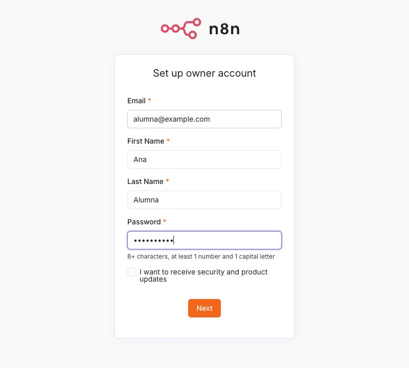
*Crear la cuenta de propietario (los datos son de ejemplo)*

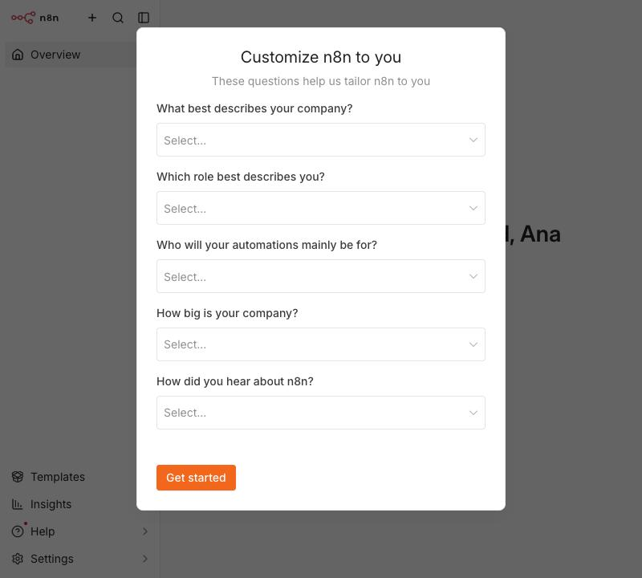
*El cuestionario opcional: pulsa Get started sin responder*

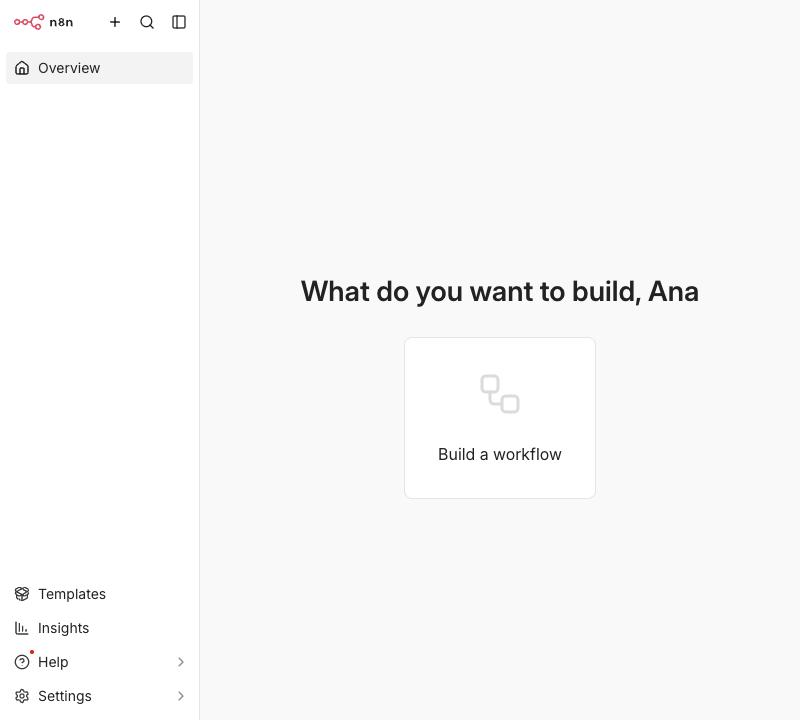
*Así se ve n8n recién estrenado*


### 1.5 Comandos que vas a usar (guárdalos)

| Quiero… | Comando |
|---|---|
| Ver qué está encendido | `docker compose ps` |
| Ver lo que escribe n8n (para buscar errores) | `docker compose logs -f n8n` (sal con `Ctrl + C`) |
| Apagar todo **sin perder nada** | `docker compose stop` (y `docker compose start` para volver) |
| Apagar y quitar los contenedores | `docker compose down` (tus flujos se conservan) |
| Empezar **de cero** | `docker compose down -v` ⚠️ borra los volúmenes: **tus flujos y credenciales desaparecen** |


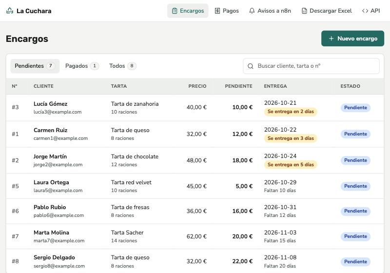
*La app de la pastelería en http://localhost:8000*

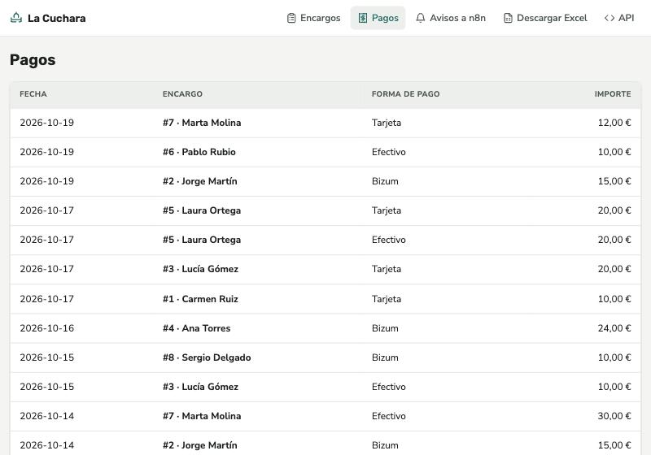
*Mailpit en http://localhost:8025, todavía sin correos*

**Checkpoint:** las cuatro URLs abren. `docker compose ps` muestra tres servicios `running`. En Mailpit todavía no hay ningún correo.

---

## Paso 2 — Conocer la app (15 min)

La app es el **mostrador** de la pastelería: ahí se apuntan encargos y pagos. n8n no la sustituye, trabaja detrás.

**La pantalla** — http://localhost:8000

1. En **Encargos** verás los 8 de ejemplo, con lo **pagado** y lo **pendiente** de cada uno, y un aviso de color cuando la entrega está cerca. Prueba el buscador y las pestañas *Pendientes / Pagados / Todos*.
2. Abre un encargo (por ejemplo el #3): ves lo pagado, una barra de progreso y la lista de pagos.
3. En **Pagos** está el historial completo. **Descargar Excel** baja todos los datos en una hoja por tabla.
4. Pulsa **Nuevo encargo**. Hay dos formas de equivocarse y cada una la avisa alguien distinto:
   - Pon una señal de **5 €**: es el **propio navegador** quien avisa («Value must be greater than or equal to 10») y no deja enviar.
   - Pon una fecha de entrega **dentro de más de 30 días** y una señal de 10 €: ahora la que lo rechaza es **la app**, y el formulario vuelve **sin perder lo que escribiste**.
   Después créalo bien.

   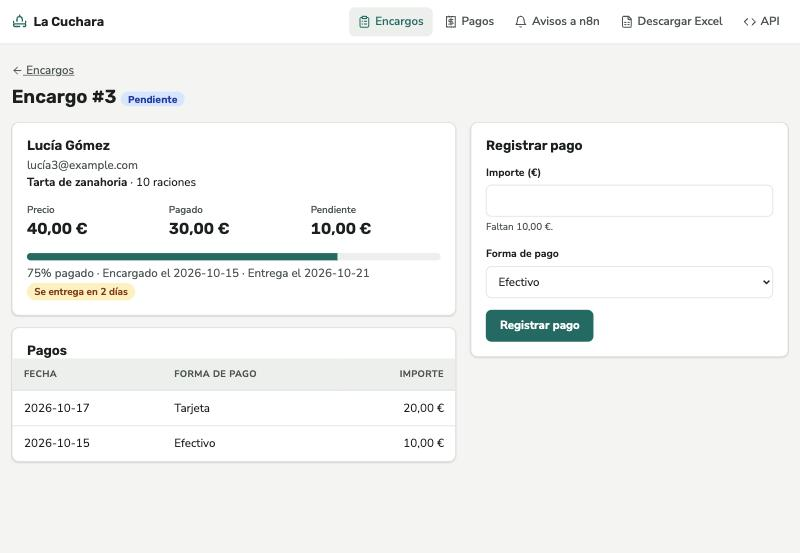
   *Ficha de un encargo: lo pagado, lo pendiente y el formulario para registrar un pago*

   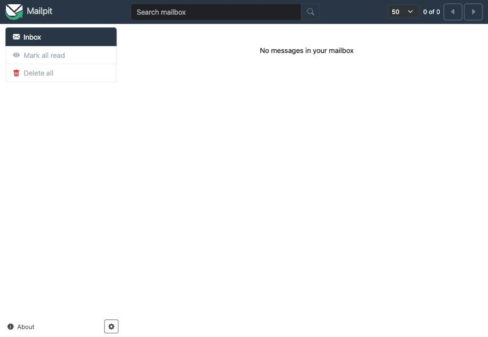
   *La pantalla Pagos, con el historial completo*

   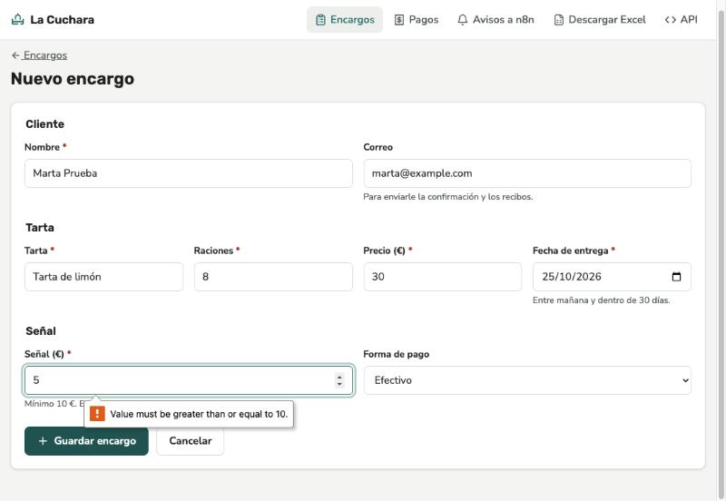
   *Con una señal de 5 € el navegador avisa antes de enviar*

   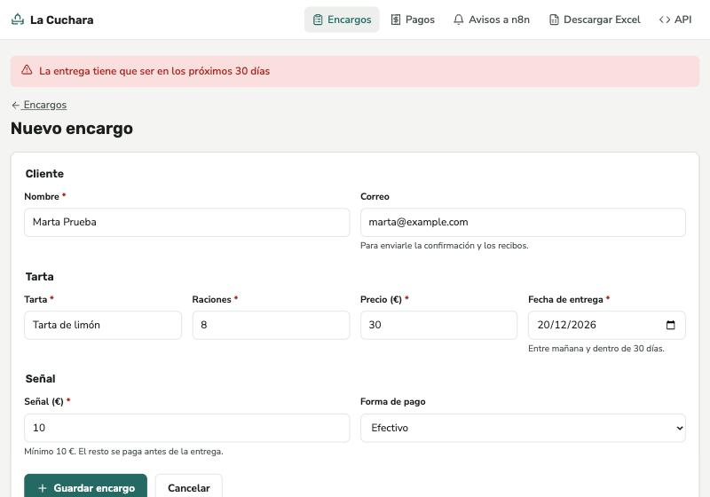
   *Con una entrega a más de 30 días la rechaza la app, y conserva lo escrito*

   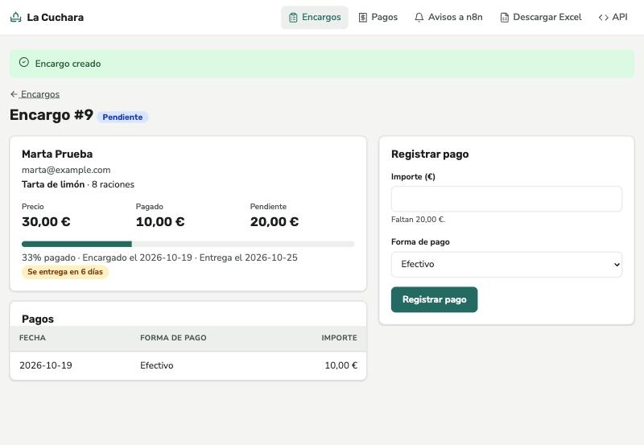
   *Encargo creado correctamente*


**Las reglas** que aplica la app (tú no las programas, las usas):

| Regla | Detalle |
|---|---|
| Señal | Mínimo **10 €** al crear el encargo |
| Entrega | Entre mañana y dentro de **30 días** |
| Pagos | Se puede pagar en partes, pero **nunca más de lo que falta** |
| Pagado | Cuando lo pendiente llega a 0 €, el encargo pasa a `pagado` |

**La API** — http://localhost:8000/docs

Es lo que usará n8n. Pulsa **Authorize** (arriba a la derecha) y escribe el valor de `API_KEY` de tu `.env` (`cambia-esta-clave`). Prueba `GET /api/encargos` (**Try it out → Execute**): los mismos encargos, pero como datos.

La pantalla que acabas de usar **también pide sus datos a esta API**: es un cliente más, igual que lo será n8n. Por eso, en el repositorio, la interfaz está en `frontend/` y la lógica en `backend/` (en el README de `main` tienes el esquema).

### Los cuatro flujos que vas a construir

| Flujo | Qué hace | Sesión |
|---|---|---|
| **01** Eventos de la pastelería | Cuando la app avisa, manda al cliente la confirmación del encargo y los recibos de pago | 1 |
| **02** Cierre diario | Cada noche suma lo cobrado en el día y se lo manda a Marisa | 1 |
| **00** Avisar de errores | Si un flujo falla, avisa a Marisa con el motivo | 2 |
| **03** Pagos por correo | Lee los avisos del banco con IA y registra cada pago en su encargo | 2 |

---

## Paso 4 — Flujo 01: confirmar encargos y mandar recibos (40 min)

**Objetivo:** cuando la app avise de un evento, enviar el correo adecuado al cliente.

| Sesión | Rama | Pasos | Duración | Al terminar tienes funcionando |
|---|---|---|---|---|
| **1** | `sesion-1` | 1 a 5 | ~1 h 50 | Todo levantado y conectado, los **avisos al cliente** (flujo 01) y el **cierre de caja** (flujo 02) |
| **2** | `sesion-2` | 6 a 9 | ~2 h | **Aviso de errores** (flujo 00), **pagos por correo con IA** (flujo 03), un flujo hecho con el agente y todo subido a tu repositorio |

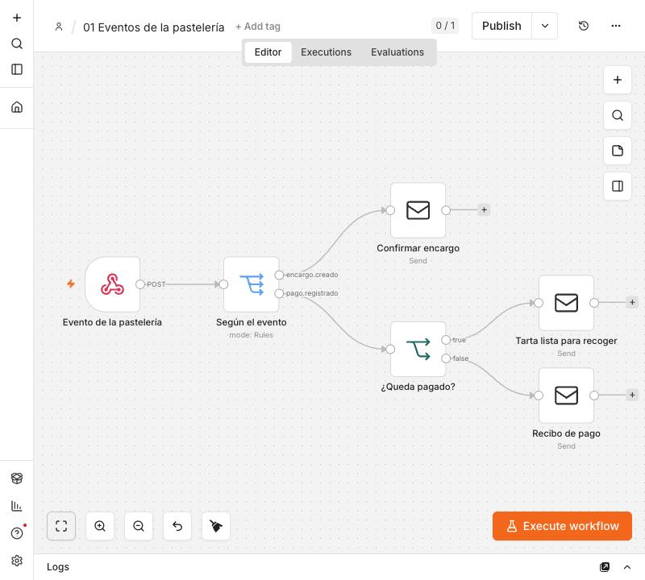
*Flujo 01 completo: webhook, Switch, un IF y tres correos*

### 4.1 Crear el flujo y el disparador

1. **Create workflow** (esquina superior). Ponle nombre arriba: `01 Eventos de la pastelería`.
2. **Add first step** → busca **Webhook** y añádelo. Configúralo:

| Campo | Valor |
|---|---|
| HTTP Method | `POST` |
| Path | `pasteleria` |
| Respond | `Immediately` |

Renombra el nodo a `Evento de la pastelería` (clic en el nombre o `F2`).

> **Dos URLs, una trampa.** El nodo muestra una **Test URL** (`/webhook-test/pasteleria`) y una **Production URL** (`/webhook/pasteleria`). La **Test URL** solo funciona unos segundos, cuando pulsas *Listen for test event* o *Execute workflow*. La **Production URL** solo funciona cuando el flujo está **publicado**. La app usa la de producción.

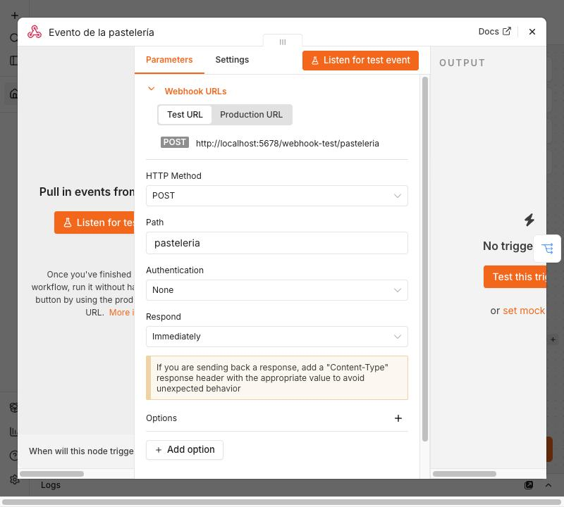
*El nodo Webhook con la pestaña Test URL*

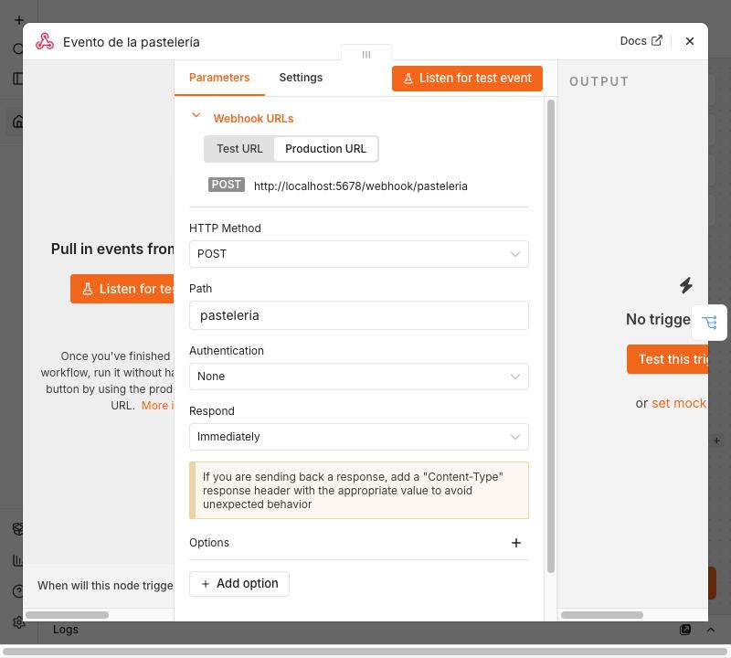
*La misma pantalla con la pestaña Production URL: es la que usa la app*


### 4.2 Probar con un evento de mentira

Para desarrollar sin tocar la app, simulamos el aviso con `curl`. En n8n, pulsa **Listen for test event** (o *Execute step*) en el nodo Webhook y **en los siguientes 2 minutos** ejecuta en tu terminal:

```bash
git clone https://github.com/Factoria-F5-madrid/clase-n8n-pasteleria.git clase-n8n-pasteleria
cd clase-n8n-pasteleria
git switch sesion-1          # y en la segunda sesión: git switch sesion-2
```

El nodo se llena con el aviso. Fíjate en la pestaña **Output**: los datos están en `body.evento` y `body.datos`. **Anota esto: el JSON que envía la app está dentro de `body`.**


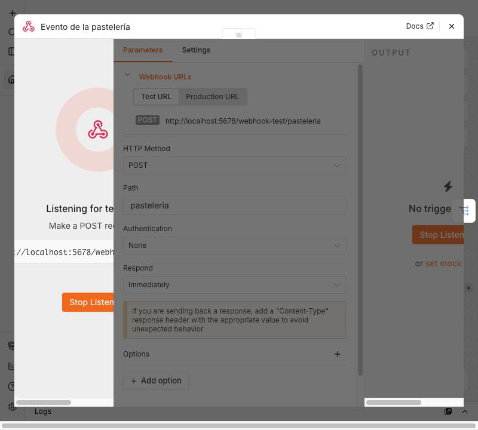
*Tras pulsar «Listen for test event», n8n espera el aviso (tienes un par de minutos)*


*Llega el aviso: los datos están dentro de `body` (cambia a la vista JSON arriba a la derecha)*

### 4.3 Repartir según el evento (Switch)

1. Añade un nodo **Switch** conectado al Webhook. Renómbralo `Según el evento`.
2. **Mode:** `Rules`. Crea dos reglas:

| Regla | Value 1 (expresión) | Operador | Value 2 | Renombrar salida a |
|---|---|---|---|---|
| 1 | `{{ $json.body.evento }}` | String → is equal to | `encargo.creado` | `encargo.creado` |
| 2 | `{{ $json.body.evento }}` | String → is equal to | `pago.registrado` | `pago.registrado` |

> Para escribir una **expresión**, en el campo pulsa *Expression* (o escribe `{{`). Todo lo que va entre `{{ }}` es JavaScript que n8n calcula para cada item.

Pulsa **Execute step**: con el evento `encargo.creado` el item sale por la salida 1.


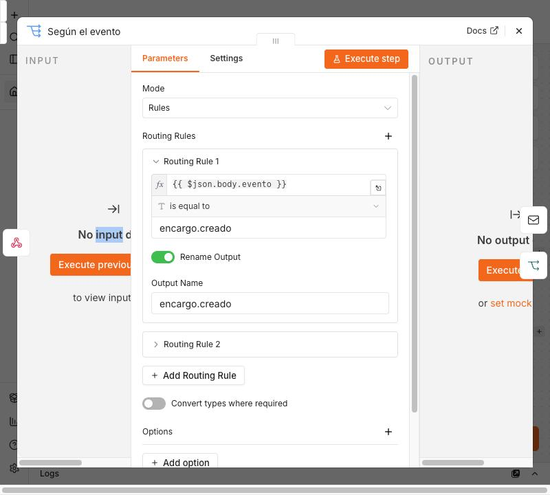
*Las reglas del Switch (aquí la 1 desplegada)*

### 4.4 Correo de confirmación

En la salida `encargo.creado` añade el nodo **Send Email** (el de *Send email*, con el sobre). Renómbralo `Confirmar encargo`:

| Campo | Valor |
|---|---|
| Credential | `Mailpit` |
| From Email | `pasteleria@lacuchara.example` |
| To Email | `{{ $json.body.datos.email }}` |
| Subject | `Tu encargo #{{ $json.body.datos.id }} está confirmado` |
| Email Format | `Text` |
| Text | ver abajo |

```
Hola {{ $json.body.datos.cliente }},

Hemos apuntado tu encargo: {{ $json.body.datos.tarta }} para {{ $json.body.datos.raciones }} raciones.

Precio: {{ $json.body.datos.precio.toFixed(2) }} €
Pagado: {{ $json.body.datos.pagado.toFixed(2) }} €
Pendiente: {{ $json.body.datos.pendiente.toFixed(2) }} €
Entrega: {{ $json.body.datos.fecha_entrega }}

Pastelería La Cuchara
```

En **Options** (*Add option*) desactiva **Append n8n Attribution** para que no añada la firma de n8n.

Pulsa **Execute step** y abre **Mailpit** (http://localhost:8025): el correo debe estar allí.

> **Los importes los da la app, nunca los calculamos nosotros.** `toFixed(2)` solo los muestra con dos decimales.


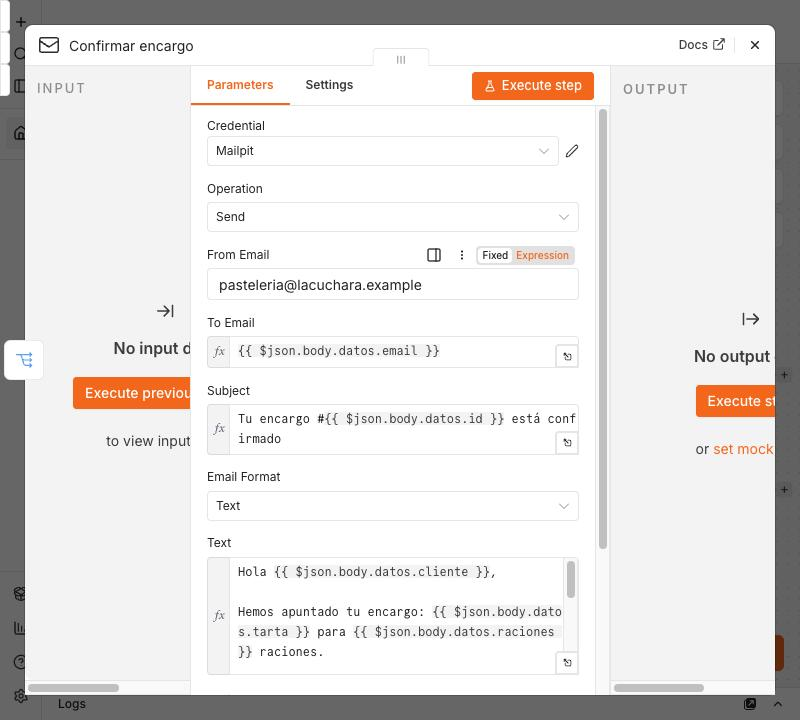
*El nodo «Confirmar encargo»: credencial, remitente, destinatario, asunto y texto con expresiones*

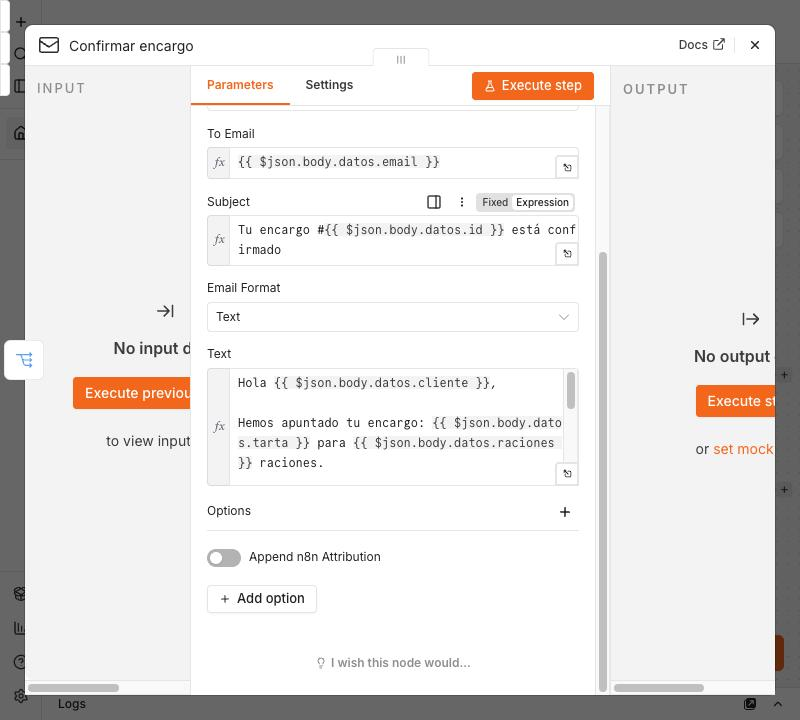
*Más abajo, la opción para quitar la firma de n8n (Append n8n Attribution apagada)*

### 4.5 Recibo de pago o "ya está pagado" (IF)

Conecta la salida `pago.registrado` del Switch a un nodo **IF** llamado `¿Queda pagado?`:

| Campo | Valor |
|---|---|
| Value 1 | `{{ $json.body.datos.estado }}` |
| Operador | String → is equal to |
| Value 2 | `pagado` |

Ahora **dos** nodos **Send Email** (credencial `Mailpit`, mismo remitente, `To` = `{{ $json.body.datos.email }}`):

- Salida **true** → `Tarta lista para recoger`
  - Subject: `Tu encargo #{{ $json.body.datos.id }} está pagado`
  - Text: `Hola {{ $json.body.datos.cliente }}, hemos recibido {{ $json.body.datos.importe.toFixed(2) }} € y tu encargo ya está pagado por completo. Te esperamos el {{ $json.body.datos.fecha_entrega }} para recoger tu {{ $json.body.datos.tarta }}.`
- Salida **false** → `Recibo de pago`
  - Subject: `Recibo de tu pago del encargo #{{ $json.body.datos.id }}`
  - Text: `Hola {{ $json.body.datos.cliente }}, hemos recibido {{ $json.body.datos.importe.toFixed(2) }} €. Te quedan por pagar {{ $json.body.datos.pendiente.toFixed(2) }} € antes de la entrega ({{ $json.body.datos.fecha_entrega }}).`

Prueba el IF con dos `curl`, uno por cada rama. Para cada uno:

1. Cierra el nodo y pulsa **Execute workflow** (abajo): n8n se queda esperando un aviso, igual que antes.
2. Pega el comando en tu terminal y pulsa Enter.
3. Mira el lienzo: el camino que ha seguido el aviso se pone en verde, y el correo llega a Mailpit.

**Rama «pagado»** (ya no debe nada: sale por *true*, «Tarta lista para recoger»):

```bash
curl -X POST http://localhost:5678/webhook-test/pasteleria \
  -H "Content-Type: application/json" \
  -d '{"evento":"pago.registrado","datos":{"id":99,"cliente":"Ana Prueba","email":"ana@example.com","tarta":"Tarta de queso","raciones":8,"precio":32,"pagado":32,"pendiente":0,"estado":"pagado","fecha_entrega":"2026-12-01","importe":10}}'
```

**Rama «pendiente»** (todavía debe algo: sale por *false*, «Recibo de pago»). Vuelve a pulsar **Execute workflow** antes de pegarlo:

```bash
curl -X POST http://localhost:5678/webhook-test/pasteleria \
  -H "Content-Type: application/json" \
  -d '{"evento":"pago.registrado","datos":{"id":99,"cliente":"Ana Prueba","email":"ana@example.com","tarta":"Tarta de queso","raciones":8,"precio":32,"pagado":10,"pendiente":22,"estado":"pendiente","fecha_entrega":"2026-12-01","importe":10}}'
```

La única diferencia entre los dos son `pagado`, `pendiente` y `estado`. El IF solo mira `estado`.


*El IF «¿Queda pagado?»: estado igual a `pagado`*

### 4.6 Publicar y probar con la app de verdad

1. Pulsa **Publish** (arriba a la derecha). Se abre una ventana que pide un **nombre de versión** (ya viene uno puesto): pulsa **Publish** otra vez. Después sale un aviso de «Workflow published»: pulsa **Got it**. Un flujo publicado escucha la **Production URL** sin que tengas que pulsar nada.

   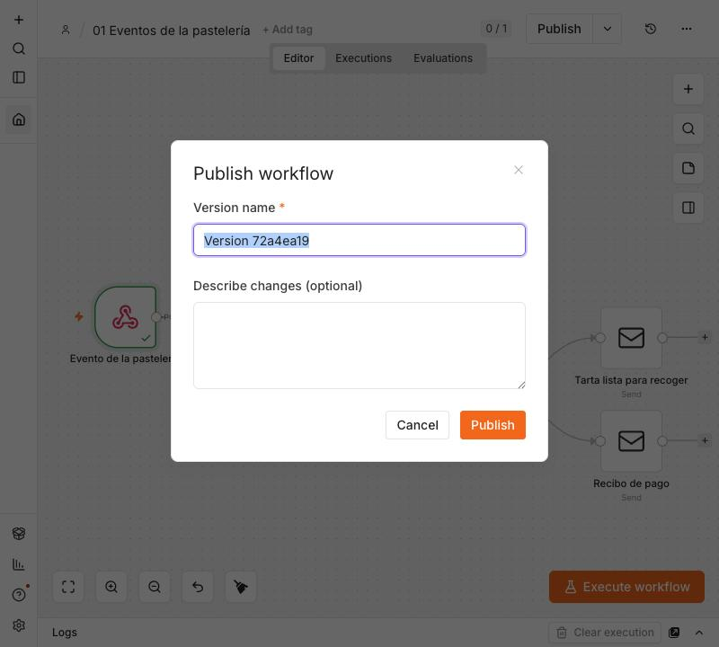
   *La ventana de Publish: deja el nombre de versión y confirma*

   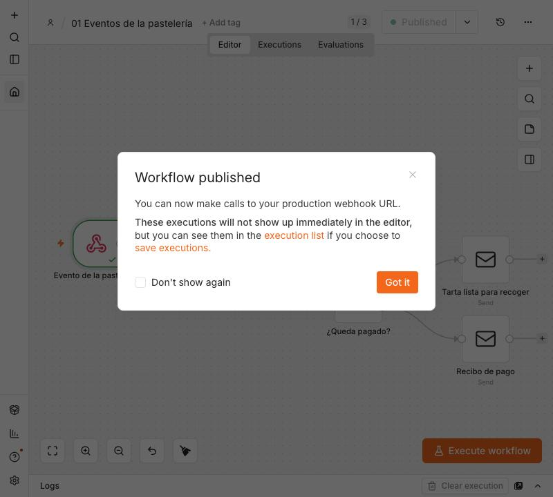
   *Aviso de flujo publicado*

2. En la app (http://localhost:8000) pulsa **Nuevo encargo**. Pon tu nombre, un correo inventado (`tu@correo.example`), una tarta de 30 €, una fecha de entrega entre mañana y dentro de 30 días y una señal de 10 €.
3. En la app, abre **Avisos a n8n**: el aviso nuevo dice **«Enviado. n8n respondió 200»** (antes decía 404). En Mailpit llega **«Tu encargo #9 está confirmado»**.
4. En la ficha del encargo, **Registrar pago** de 10 €: llega el **recibo**. Registra otros 10 €: ahora faltan 10 € todavía. Registra los últimos 10 €: el encargo queda pagado y llega **«Tu encargo está pagado»**.
5. Mira la pestaña **Executions** del flujo: cada aviso es una ejecución, con sus datos. (Las ejecuciones de un flujo publicado **no aparecen en el lienzo** al momento: se ven aquí.)

   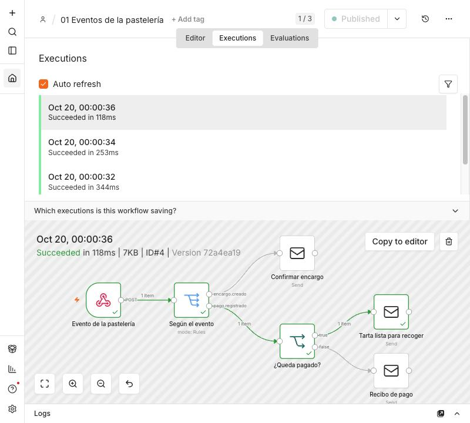
   *Las ejecuciones del flujo: la última muestra el camino que siguió el aviso*

   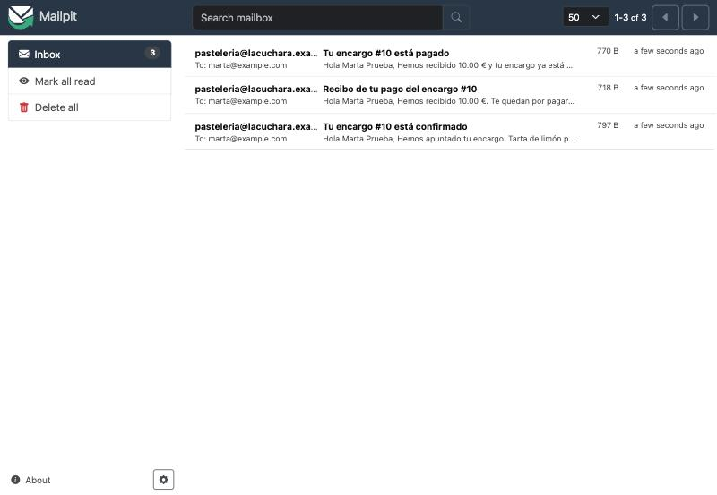
   *Mailpit con los tres correos al cliente*

   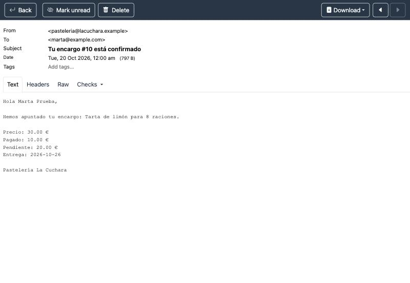
   *El correo de confirmación, con los importes que dio la app*

   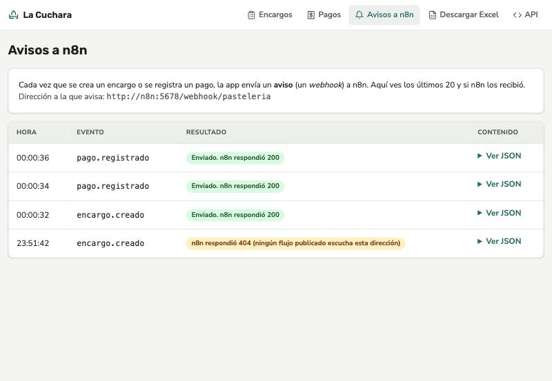
   *Avisos a n8n: el primero decía 404, los nuevos dicen «Enviado. n8n respondió 200»*


**Checkpoint:** tres correos distintos en Mailpit y tres ejecuciones verdes. Con este flujo, cada encargo y cada pago avisan al cliente solos.


## Cómo está hecha la app (por si tienes curiosidad)

No tienes que tocarla, pero conviene entenderla porque **n8n va a hablar con ella**. Sigue el patrón **MVC**, que separa tres responsabilidades. Piensa en un restaurante:

| Pieza | Carpeta | En el restaurante | Qué hace |
|---|---|---|---|
| **M**odelo | `backend/models/`, `backend/database.py` | La cocina | Guarda los datos y aplica las reglas (señal mínima de 10 €, entrega en 30 días...) |
| Schemas | `backend/schemas/` | La comanda | La forma exacta de los datos que entran y salen (con Pydantic) |
| Rutas | `backend/routes/` | El plano de la sala | Dice qué mesa (URL) atiende qué camarero (función): «los encargos nuevos los lleva `crear`» |
| **C**ontrolador | `backend/controllers/` | El camarero | La lógica de cada petición: se la pasa a la cocina y devuelve la respuesta |
| Middleware | `backend/middleware/` | El portero | Actúa antes o alrededor: comprueba la clave de la API y convierte los errores en respuestas claras |
| **V**ista | `frontend/` | El comedor y la carta | Lo que ve y usa la dependienta: HTML, CSS y JavaScript |
| `main.py` | `backend/main.py` | El encargado | Solo junta las piezas, no tiene lógica |

La idea clave: **la interfaz no tiene reglas ni toca la base de datos**. Pide todo a la API, igual que lo hará n8n. Es como si la pantalla y n8n fueran dos clientes del mismo camarero:

```
 Pantalla (frontend/) ─┐                 ┌─ middleware/ (clave)
                       ├──▶ routes/ ──▶ controllers/ ──▶ models/ ──▶ base de datos
 n8n ──────────────────┘
```

Por eso la carpeta se llama `frontend/` y no `templates/`: no son plantillas que rellena el servidor, es una interfaz que **consulta la API**.

---

## Paso 8 — Repetir un flujo con el agente (30 min)

Hasta aquí has construido a mano para entender cada pieza. Ahora trabajarás con un agente de IA: le pides **un flujo nuevo** y tú haces de *tech lead*: defines, revisas y decides.

### 8.1 Dale contexto: `AGENTS.md`

Crea este archivo en la raíz de tu carpeta y adáptalo:

```markdown
# Pastelería La Cuchara: automatizaciones con n8n

- La app (http://pasteleria:8000 dentro de Docker) guarda encargos y pagos. Se usa por API con la cabecera X-API-Key (credencial "API Pastelería" en n8n).
- n8n corre en Docker. Los correos salen por la credencial SMTP "Mailpit".
- Los flujos se guardan como JSON en `mis-flujos/` con el formato `NN-nombre.json`.
- Los importes siempre los calcula la app: n8n solo los muestra.
- NO escribir credenciales ni claves dentro de los JSON. NO publicar flujos sin que yo los haya probado.
```

### 8.2 Escribe la spec antes de pedir nada

Ejemplo para un flujo nuevo, **Aviso de entrega mañana**:

```markdown
## Spec: aviso de entrega mañana
- Disparador: cada día a las 9:00.
- Pide a la API los encargos `pendiente` y `pagado` con `fecha_entrega` de mañana (GET /api/encargos).
- Si un encargo está `pagado`: correo al cliente "Mañana puedes recoger tu tarta".
- Si está `pendiente`: correo al cliente "Mañana es la entrega y aún te faltan X €".
- Si hay entregas mañana, un solo correo a Marisa con la lista. Si no hay ninguna, no se envía nada.
- Criterios de aceptación: con los datos de ejemplo, el resultado coincide con lo que dice la app; no falla si no hay entregas.
```

### 8.3 Pídeselo al agente y revísalo

1. Abre OpenCode en la carpeta y pega la spec con una frase como: *"Lee AGENTS.md y esta spec. Genera el flujo como un JSON importable en `mis-flujos/04-aviso-entrega.json`."*
2. En n8n: **Import from file** (menú `···` del flujo, imagen del Paso 6). Las credenciales llegan sin asignar: abre cada nodo con un aviso y selecciona la tuya.
3. **Revisa como si lo hubiera hecho otra persona**, con esta lista:

| Comprobación | ¿Está bien? |
|---|---|
| Los importes los toma de la app, no los calcula | |
| No hay claves escritas en los nodos | |
| Funciona con el caso de no haber entregas mañana | |
| Los nombres de los nodos se entienden | |
| Los textos de los correos son correctos | |

4. Si falla, **pásale el error y el flujo** (no solo "no funciona") y pide la corrección.
5. Anota en `docs/ai-log.md`: el prompt, qué hizo bien, qué tuvo que corregirse.

> **Opcional:** [n8n-mcp](https://github.com/czlonkowski/n8n-mcp) conecta el agente con tu n8n (necesita una API key de n8n: *Settings → n8n API*) para que cree y pruebe los flujos él mismo. Úsalo cuando ya domines lo básico.

---

## Paso 9 — Exportar y subir a Git (15 min)

Los flujos viven dentro de n8n. Para guardarlos y compartirlos hay que **exportarlos a JSON**.

1. En cada flujo: menú `···` (la misma de la imagen del Paso 6) → **Download**. Guárdalo en `mis-flujos/` con el formato `NN-nombre.json`.
2. **Revisa que no hay secretos:** abre el JSON y busca tu clave de Groq o tu `API_KEY`. n8n solo guarda el **nombre y el id** de las credenciales, no su contenido, pero comprueba. Los textos pegados dentro de un nodo sí se exportan.
3. Sube a **tu propio repositorio** (no al de la clase):

```bash
git remote -v                      # debe salir TU repositorio, no el de Factoría F5
git switch -c flujos-esenciales
git add mis-flujos/ AGENTS.md
git commit -m "Añade flujos 00, 01, 02 y 03"
git push -u origin flujos-esenciales
```

   Si todavía apunta al de la clase: `git remote remove origin`, crea un repo vacío en GitHub y `git remote add origin <url-de-tu-repo>`.

> **Reimportar:** en un n8n nuevo, **Import from file** con cada JSON y vuelve a asignar las credenciales. Dentro de `referencia/` de esta rama tienes los cuatro flujos terminados: úsalos solo para comparar o si te atascas. Importa primero el `00` (los otros ya lo tienen elegido como *Error workflow*) y **publícalo**.

---

## 10. Errores típicos de esta sesión

| Síntoma | Causa | Solución |
|---|---|---|
| Marisa no recibe el aviso de error | El flujo `00` no está publicado o no lo has elegido en *Settings → Error workflow* | Publícalo y asígnalo en cada flujo |
| En el nodo de Groq, el campo Model dice `Error fetching options from Groq Chat Model` | La API key de la credencial `Groq` no es válida o no está bien copiada | Abre la credencial, pega de nuevo la clave de console.groq.com y guarda |

| La IA devuelve el importe como texto o mezcla campos | Prompt poco claro | Mejora el prompt y baja la temperatura a 0 |
| `401` en el modelo | La API key de Groq no está bien copiada | Revisa la credencial `Groq` |
| El pago de un caso ya no se registra al repetirlo | El encargo ya está pagado: cada pago cambia la app | Restablece los datos (ver Paso 7) |
| Un nodo importado tiene un triángulo rojo | La credencial importada no existe en tu n8n | Abre el nodo y elige tu credencial |
| `ECONNREFUSED 127.0.0.1` | Estás usando `localhost` dentro de n8n | Usa `mailpit` y `http://pasteleria:8000` |

---

## 11. Para cerrar

Comprueba que puedes **explicar con tus palabras**:

1. ¿Por qué la app avisa a n8n con un webhook, en lugar de que n8n pregunte cada minuto?
2. ¿Por qué en el flujo 03 la IA no decide a qué encargo va cada pago?
3. ¿Qué pasa con el cierre de caja si ese día no se cobró nada y no activas *Always Output Data*?
